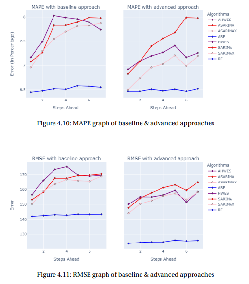

# Call-Count Forecasting for the NYC 311 call center

**Master's thesis (time-series part):** forecasting daily call volume at New York City's 311 service center, so staffing can be planned ahead.

Data comes from NYC Open Data through the **SODA API**. I compared classic statistical models with machine learning, and clustered the call descriptions (text) into categories to forecast each one separately and add them up.

## Results

**Clustering call types first, then forecasting each cluster and summing up ("Aggregated Random Forest") was the best model**, for every horizon from 1 to 7 days ahead. It kept an error of about **6.5% MAPE**, while SARIMAX rose to about 8% further ahead.

| Model (approx. values from the thesis figures) | RMSE, 1 day ahead | RMSE, 7 days ahead | MAPE |
|---|---|---|---|
| SARIMAX | ~150 | ~169 | 7.0–7.9% |
| SARIMAX on clusters | ~144 | ~158 | 6.5–7.2% |
| Random Forest | ~142 | ~143 | ~6.5% |
| **Aggregated Random Forest (clusters)** | **~124** | **~126** | **~6.5%** |

That is about 13% lower RMSE than a single Random Forest and about 25% lower than SARIMAX at 7 days ahead. Data: daily 311 inquiries, Jan 2020 to Sep 2022; RMSE is in inquiries per day.

## What's in the repo

| Folder | Contents |
|---|---|
| `01-exploratory-data-analysis` | Data download via SODA API, daily/weekly/monthly/quarterly patterns, time-series analysis |
| `02-proof-of-concept` | Moving averages, decomposition, Holt-Winters exponential smoothing, ARIMA |
| `03_Statistical_Models` | SARIMA and SARIMAX (single-step and multi-step), scores |
| `04_ML_Models` | Random Forest regression on stationary and non-stationary data |
| `05-Clustering` | HDBSCAN and K-Means on call types, forecasts per cluster |

## Stack

Python · pandas · statsmodels · scikit-learn · HDBSCAN · Jupyter
